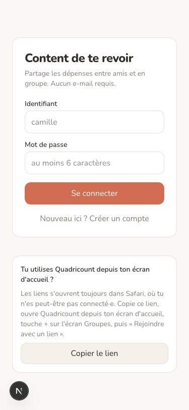
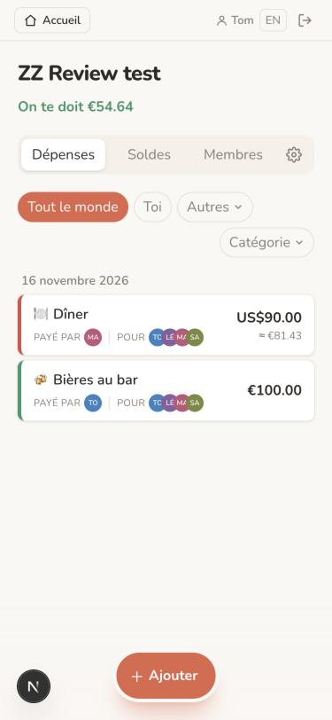
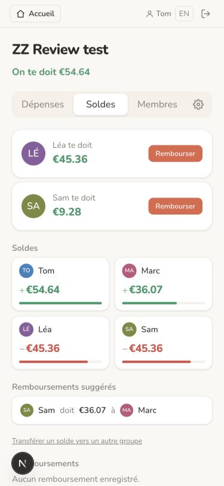
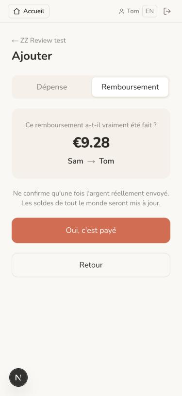
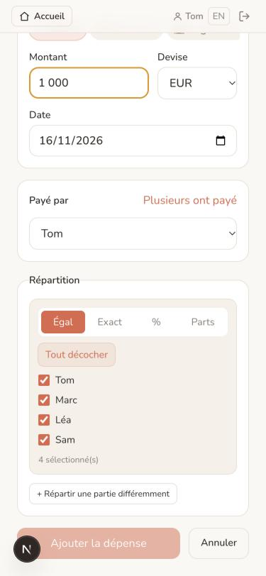
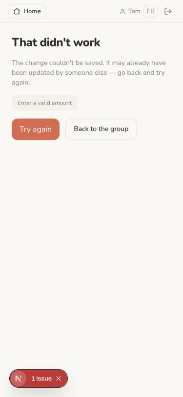
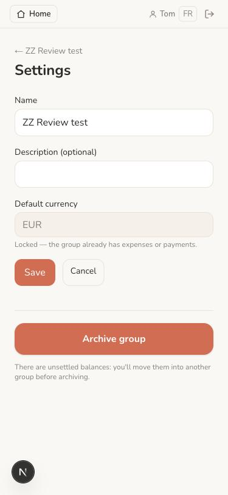
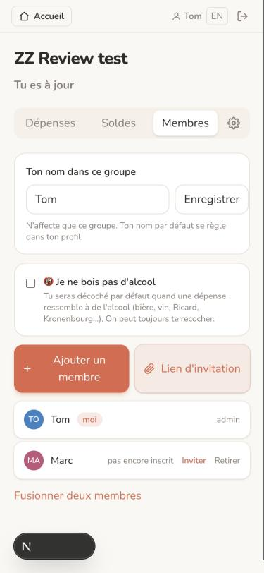
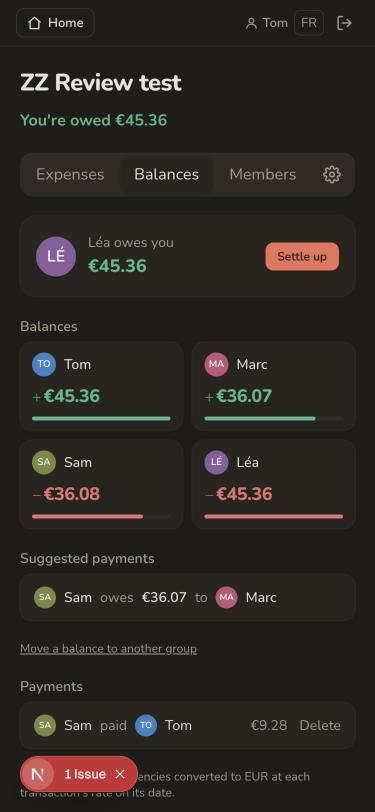

# Quadricount: UX, blocker and logic review

Reviewed 16 November 2026 on the local dev server (commit `795207f`), which uses the same database as the live app.

**How to read the evidence tags**

| Tag | Meaning |
| --- | --- |
| **[Used]** | I saw it happen in the running app. |
| **[Ran]** | I ran the project's own code (for example `src/lib/balances.ts`) with test inputs. |
| **[Read]** | I read it in the code and did not trigger it. |
| **[Inferred]** | A conclusion from the code that I could not confirm. Treat as "probably". |

**What I could not test:** creating a new account, joining as a second person, the onboarding steps after the first screen, receipt scanning (no API key locally), cross-group transfer, archiving, the production build, and a real iPhone (keyboard and home-screen behaviour). Findings in those areas are **[Read]** or **[Inferred]**.

**Test data left behind:** one group named "ZZ Review test" (2 expenses, 1 payment, 3 placeholder members). I could not remove it because the app no longer has a way to delete a group (see finding 12).

---

## 1. Summary

### Verdict

The core of the app is good. The balances screen is clearer than Tricount's, the payment confirmation step is well judged, the split form hides its complexity until you need it, and the database refuses to save an expense whose shares do not add up. Dark mode and both languages work.

The weak points are at the edges of the core: the first five minutes for an organiser, what happens when something goes wrong, and a small set of calculation and formatting bugs that show up as soon as a group uses two currencies. None of these needs a redesign.

### The five changes that would help most

1. **Let the organiser add people while creating the group, and offer the share link straight away.** Today a new group contains only you, and the next step (the Members tab) is not signposted. (Findings 1, 2, 3)
2. **Make the add-expense form faster and more forgiving.** Focus the first field, keep the Add button visible above the keyboard, accept amounts like `1 000` or `1 234,56`, and show a reason next to the field instead of a greyed-out button. (Findings 4, 5, 6)
3. **Show errors where they happen.** Validation errors currently replace the whole page with a "That didn't work" screen, the typed data is lost, and in production the real reason is hidden. (Finding 7)
4. **Protect people from losing things.** Deleting an expense takes one tap with no confirmation or undo. Sign out sits beside the language switch, and there is no password reset. (Findings 8, 9, 10)
5. **Fix the money maths and formatting for mixed currencies.** Balances can be 1 cent off and never reach zero, a missing exchange rate silently counts as 1:1 (after a failed lookup, and probably whenever a non-owner edits someone else's foreign expense), and amounts are formatted differently by the server and the phone. (Logic 1, 2, 2b and finding 19)

### Broken right now

| # | Problem | Evidence |
| --- | --- | --- |
| A | A payment typed as `1 000` passes the "Has this really been paid? €1,000.00" confirmation, then fails with "That didn't work". | [Used] |
| B | In a group with a foreign-currency expense, balances did not add up to zero (they summed to −€0.01). One member showed −€36.08 while the suggested payment was €36.07, so that member can never reach zero. | [Used] |
| C | Every page that lists expenses logs a React "Hydration failed" error, because the server and the browser format money differently. The amount visibly changes after load. | [Used] |
| D | Light theme text and buttons are below the WCAG AA contrast minimum (measured 3.4 to 3.8 against a required 4.5). | [Ran] |
| E | A group cannot be deleted. It can only be archived, and only after every balance is zero. | [Used] |
| F | The sign-up form says "you can add a recovery email later", but the profile page has no such option and there is no password reset. | [Used] |
| G | Deleting an expense has no confirmation and no undo. | [Used] |

---

## 2. Flow-by-flow walkthrough

### Landing and login

**Keep:** one sentence, two buttons. Username and password only, with no email, which removes the largest sign-up obstacle.

**Problems:**
- No language switch while signed out, and the default is French regardless of the phone's language. An English-speaking invitee cannot change it until after creating an account. [Used]
- The login page shows the "Tu utilises Quadricount depuis ton écran d'accueil ?" card for any redirect, including a plain `/balances` visit on a laptop, where it makes no sense. [Used] (`src/app/login/page.tsx:170`)
- No "show password" control and no second password field, combined with no reset (finding 10).
- Wrong-password errors are translated, but any other error is shown as raw English text from the server (`src/app/login/page.tsx:58-63`). [Read]

### First run for an organiser

Sign up, then six onboarding screens (hello, how it works, name, payment details, alcohol preference, done), then create a group.

**Keep:** the new-group form has one required field. Group type is optional and clearly marked.

**Problems:** the onboarding asks for an IBAN and an alcohol preference before the person has seen the product (finding 3). The new group then opens like this:

The most prominent card is about importing balances from another app, which few people need. The empty state says "add the first expense", but the group only contains you. Adding people is in the third tab (findings 1, 2).

### Joining from a shared link

Signed out, the invite page reads: "Rejoindre ZZ Review test. Partagez vos dépenses ensemble. Connecte-toi ou crée un compte pour continuer. [Continuer]". [Used, as page text]

Then: create an account (2 fields), then "Is this you?" or pick a name, then Join. That is about 5 taps and 2 typed fields.

**Keep:** the "is this you?" matching against existing placeholder names is a strong idea, and it means balances recorded before the person joined carry over to them. Sign-up from an invite skips the six onboarding screens.

**Problems:** the page does not say who invited you, how many people are in the group, or that it is free and needs no email. It asks for an account before showing anything (finding 13). The link can only be copied, not shared (finding 2).

### Adding an expense

Fastest path on a phone: tap **+ Ajouter**, tap the description, type, tap the amount, type, close the keyboard, scroll, tap **Ajouter la dépense**. Five taps plus a scroll.

**Keep:** you are the default payer, everyone is ticked, the date is today, the category is guessed from the description ("Bières au bar" selected Boissons), and "Plusieurs ont payé" and "Répartir une partie différemment" stay hidden until wanted. Foreign currency shows the converted amount underneath. The list's coloured edge and avatar stacks are readable at a glance.

**Problems:** no field is focused on open, the submit button is below the fold, bad amounts disable the button without explanation, and server errors lose the form (findings 4 to 7). Each row shows the total but not your own share (finding 14).

### Understanding who owes whom

**Keep almost everything.** Your own debts come first in large type with a button, everyone's balance is a compact grid with bars, and other people's suggested payments are separated below. This is the best screen in the app.

**Problems:** the rounding bug (Logic 1) is visible here. In French the button on "Léa te doit €45.36" says **Rembourser**, which reads as "pay back" when you are the one being paid (finding 15).

### Settling up

Balances tab, **Rembourser**, **Continuer**, **Oui, c'est payé**. Four taps.

**Keep:** the confirmation step. It restates the amount and direction in one glance and warns that balances will change. Payment details with copy buttons on the form are useful.

**Problems:** after confirming you land on the Expenses tab, where the payment is not listed, with no message (finding 16). When you open the form from **+** instead of from a balance, it defaults to the first two members rather than "me to the person I owe" (finding 17).

### Coming back after weeks away

**Keep:** the home screen answers "do I owe anything?" immediately, and the mascot gives the settled state some warmth.

**Problems:** if you are signed out and have forgotten the password, there is no way back in (finding 10). There is no record of what changed while you were away: no activity list, no "added by", no edit history (finding 18).

### Desktop, languages, dark mode

- **Desktop:** a single 512px column in the middle of the screen. It works. Low priority.
- **English and French:** both complete in the screens I visited. Database error messages are English only.
- **Dark mode:** follows the system setting and looks good. Contrast passes in dark mode and fails in light mode (finding 11).

---

## 3. Findings

Severity: **High** stops or misleads people, **Medium** slows or confuses them, **Low** is polish.

### 1. A new group contains only you, and nothing points to adding people. High

- **Observed [Used]:** after "Créer le groupe" the page shows an "import balances from another app" card and "Aucune dépense pour l'instant, ajoute la première". Members are in the third tab. I could add an expense split between only myself.
- **Where:** `src/app/groups/new/page.tsx`, `src/app/groups/[id]/page.tsx:501-512`.
- **Who:** every organiser, on their first group. This is the moment people decide whether the app is worth the effort.
- **Why:** Tricount asks for participants as part of creating a tricount ([how tricount works](https://tricount.com/en/how-tricount-works)), and people expect new apps to behave like the ones they know ([Jakob's law](https://lawsofux.com/jakobs-law/)). An empty state should say what to do next ([NN/g on empty states](https://www.nngroup.com/articles/empty-state-interface-design/)).
- **Fix:** add a "Qui participe ?" field to the new-group form: a text input that turns each name into a chip when you press Enter or comma. On submit, call `add_group_member` once per name. Then change the empty state to two buttons, **Inviter le groupe** (share link) and **Ajouter une dépense**, and move the opening-balances card to a small text link under them.

### 2. The invite link can only be copied, and it is hidden behind a button on the Members tab. High

- **Observed [Used]:** Members tab, tap "Lien d'invitation", a truncated URL and a **Copier** button appear. To send it you copy, leave the app, open WhatsApp and paste.
- **Where:** `src/app/groups/[id]/MembersToolbar.tsx:128-141`, `src/components/CopyLink.tsx`.
- **Who:** every organiser on a phone.
- **Why:** every extra step lowers the chance the action happens ([Fogg behaviour model](https://behaviormodel.org/): behaviour needs motivation, ability and a prompt).
- **Fix:** in `CopyLink`, if `navigator.share` exists, show a primary **Partager** button that calls `navigator.share({ title: groupName, text: "Rejoins « {group} » sur Quadricount", url })` ([Web Share API](https://developer.mozilla.org/en-US/docs/Web/API/Navigator/share)). Keep Copy as the fallback. Show the same button in the empty state from finding 1.

### 3. Onboarding asks for bank details and an alcohol preference before showing the product. Medium

- **Observed [Read, first screen Used]:** six steps in `src/app/welcome/Onboarding.tsx`, including IBAN and "do you drink?".
- **Who:** every organiser who signs up directly.
- **Why:** each question is a decision ([Hick's law](https://lawsofux.com/hicks-law/)), and asking for an IBAN before any value has been shown costs trust.
- **Fix:** keep two steps, name and "create your first group". Ask for payment details the first time someone owes this person money (a card on the Balances tab: "Léa te doit €45. Ajoute ton IBAN pour qu'elle puisse te payer"). The alcohol toggle already lives on each group's Members tab.

### 4. The expense form does not focus a field, and the Add button is below the fold. High

- **Observed [Used]:** on open, nothing is focused (`document.activeElement` was `BODY`). With four members the form is 1,104px tall on an 812px screen, so the button is always off-screen, and more so with the keyboard open. On iOS the decimal keypad has no Return key, so the only route is close keyboard, scroll, tap.
- **Where:** `src/app/groups/[id]/expenses/new/NewExpenseForm.tsx:406-417` (description), `:858-865` (button).
- **Who:** everyone, on the most frequent action. Worst for the one-handed restaurant case.
- **Why:** [Fitts's law](https://lawsofux.com/fittss-law/) and thumb reach: the primary action should be large and near the thumb ([thumb zone](https://www.smashingmagazine.com/2016/09/the-thumb-zone-designing-for-mobile-users/)).
- **Fix:** add `autoFocus` to the description input for new expenses. Make the button row `sticky bottom-0` with a background and `padding-bottom: env(safe-area-inset-bottom)`, so it stays above the keyboard. Add `enterKeyHint="next"` to the description and `enterKeyHint="done"` to the amount.

### 5. Amounts with a space or thousands separator are rejected silently. High

- **Observed [Used]:** typing `1 000` greys out the button. No message appears and the "per person" hint disappears.

  

- **Also [Ran]:** `1 234,56` and `1,234.56` are rejected. `1e3` is accepted as 1,000.00 and `0x10` as 16.00. `0.004` passes the JavaScript check and then fails in the database.
- **Where:** `NewExpenseForm.tsx:46-49`, `src/app/groups/actions.ts:69-73`.
- **Who:** anyone entering rent, a flight, or pasting an amount. French keyboards and banking apps write `1 000,00`.
- **Why:** "be liberal in what you accept" for input fields ([Baymard on input fields](https://baymard.com/blog/input-fields)), and error prevention is one of [Nielsen's heuristics](https://www.nngroup.com/articles/ten-usability-heuristics/).
- **Fix:** write one shared `parseAmount(raw)` in `src/lib/money.ts` and use it in all four places that parse amounts. It should remove spaces (including the narrow no-break space), treat the last `,` or `.` as the decimal mark, remove earlier ones, allow only digits, and return `null` when invalid. Change the placeholder to `0,00` in French.

### 6. The submit button is disabled with no explanation. Medium

- **Observed [Used]:** the same greyed button covers "no amount", "amount invalid", "nobody ticked", "percentages do not reach 100" and "payers do not add up". Some of these have a small red hint elsewhere in the form, often off-screen. An invalid amount has none.
- **Where:** `NewExpenseForm.tsx:380-383`, `:859-861`.
- **Why:** disabled buttons give no feedback about what is wrong ([NN/g video](https://www.nngroup.com/videos/why-disabled-buttons-hurt-ux-and-how-to-fix-them/), [Smashing Magazine](https://smashingmagazine.com/2021/08/frustrating-design-patterns-disabled-buttons/)).
- **Fix:** keep the button enabled. On tap, if the form is invalid, show the first problem as red text directly under the relevant field and scroll to it. Compute a single `firstError` string next to `canSubmit`.

### 7. Validation errors replace the page, lose the form, and hide the reason in production. High

- **Observed [Used]:** a payment of `1 000` showed "€1,000.00" on the confirmation screen, then:

  

  The heading text ("may already have been updated by someone else") is wrong for this case, and "Try again" returns to an empty form.
- **Why it is worse in production [Read]:** every server action reports problems with `throw new Error(...)`. The Next.js docs bundled with this project say expected errors should be returned, not thrown (`node_modules/next/dist/docs/01-app/01-getting-started/10-error-handling.md`, "Handling expected errors"), and that in production the error message is not sent to the browser (`.../03-file-conventions/error.md:106`). So on the live site the grey box with the real reason is most likely empty. I did not check the live site.
- **Where:** `src/app/groups/actions.ts` (about 30 `throw` statements), `src/app/groups/[id]/error.tsx`.
- **Why:** error messages should appear next to the problem and keep the user's work ([NN/g error-message guidelines](https://www.nngroup.com/articles/error-message-guidelines/)).
- **Fix:** follow the pattern already used in `src/app/invite/[token]/actions.ts`: the action returns `{ error: string }` and the form uses `useActionState` to show it above the button. Convert `createExpense`, `updateExpense` and `recordSettlement` first. Keep `error.tsx` for real crashes and reword it so it does not blame another user.

### 8. Deleting an expense is one tap, with no confirmation and no undo. High

- **Observed [Used]:** on an expense page, tapping **Supprimer** deleted it immediately and returned to the list with no message. The button sits beside **Modifier**. Deleting a payment does ask first, so the app is inconsistent.
- **Where:** `src/app/groups/[id]/expenses/[expenseId]/page.tsx:222-233`.
- **Who:** anyone, and the effect lands on the whole group's balances.
- **Why:** destructive actions need a confirmation or, better, an undo ([NN/g on confirmation dialogs](https://www.nngroup.com/articles/confirmation-dialog/)). Risky options should not sit beside common ones ([NN/g on proximity](https://www.nngroup.com/articles/proximity-consequential-options/)).
- **Fix (quick):** use the existing `ConfirmSubmit` component with a specific message: "Supprimer « Dîner » (90,00 $) ? Les soldes de tout le monde changeront." **Fix (better):** add a `deleted_at` column, hide deleted rows, and show "Dépense supprimée. Annuler" for a few seconds on the list.

### 9. Sign out is a 29px icon directly beside the language switch. Medium

- **Observed [Used]:** measured header targets: sign out 29×29, language 31×26, profile 52×28. A mis-tap on the language switch signs you out, with no confirmation.
- **Where:** `src/components/Header.tsx:74-97`.
- **Why:** WCAG 2.2 asks for at least 24×24 with spacing ([2.5.8 Target Size](https://www.w3.org/WAI/WCAG22/Understanding/target-size-minimum.html)). Apple's guidance is 44×44pt. Combined with finding 10, an accidental sign-out can be permanent.
- **Fix:** move sign out to the bottom of the profile page as a full-width button. Give the remaining header controls `min-h-11 min-w-11`.

### 10. There is no way to recover an account. High

- **Observed [Used]:** sign-up says "Aucune réinitialisation de mot de passe. Tu pourras ajouter un e-mail de secours plus tard." The profile page contains only display name and payment info.
- **Where:** `src/app/login/page.tsx:142-144`, `src/app/profile/page.tsx`.
- **Who:** anyone returning after weeks, on a new phone, or after an accidental sign-out. Their group memberships and balances are tied to that account.
- **Fix:** smallest step: a "show password" toggle on both forms, and a "change password" form on the profile (`supabase.auth.updateUser({ password })`). Proper fix: an optional recovery email, which needs the email sending you have deferred. Until then, remove the sentence that promises it. A group owner could also be allowed to detach a locked-out member's account so the person can re-claim their name with a new account.

### 11. Light-theme colours are below the accessibility minimum. Medium

- **Measured [Ran]** from `src/app/globals.css:4-16` (WCAG AA needs 4.5:1 for normal text, 3:1 for large text and control borders):

  | Pair | Ratio |
  | --- | --- |
  | Grey text (`--muted`) on page background | 3.59 |
  | Grey text on the beige cards | 3.39 |
  | White text on the terracotta button | 3.38 |
  | Green amounts on white | 3.53 |
  | Red amounts on white | 4.14 |
  | Input borders on background | 1.20 |

  Dark mode passes (5.5 to 6.8).
- **Who:** anyone outdoors in sunlight, which is where trip expenses are entered, and anyone with reduced vision.
- **Why:** [WCAG 1.4.3 Contrast](https://www.w3.org/WAI/WCAG22/Understanding/contrast-minimum.html), [1.4.11 Non-text contrast](https://www.w3.org/WAI/WCAG22/Understanding/non-text-contrast.html).
- **Fix:** darken four tokens. Suggested starting points to check with a contrast tool: `--muted: #6b625c`, `--primary: #c2502f`, `--pos: #1f7a52`, `--neg: #c23b34`, `--line: #cfc4b8` for input borders only.

### 12. A group cannot be deleted, and archiving a group with open balances forces a transfer. Medium

- **Observed [Used]:** Settings offers only **Archiver le groupe**. With open balances the archive page requires moving every debt into another group. There is no `deleteGroup` action in `src/` any more.

  

- **Who:** anyone who creates a group by mistake, or a test group.
- **Fix:** allow delete when the group has no expenses and no payments. On the archive page, offer two routes: "settle up first" (link to Balances) and "move the debts to another group".

### 13. The invite page asks for an account before showing anything. Medium

- **Observed [Used, as text]:** group name, one generic sentence, "sign in or create an account".
- **Why:** Tricount's own FAQ describes joining by opening the link ([who can access my tricount](https://tricount.com/en/who-can-access-my-tricount)); reviewers disagree on whether an account is always required, so treat "no account" as their intent, not a guarantee. Either way, people decide in seconds whether an unknown link is worth the effort.
- **Fix (small):** show "{Tom} t'invite à rejoindre {Voyage Lisbonne}, 4 personnes, 12 dépenses", the member avatars, and "Gratuit, sans e-mail, 20 secondes". Add the language switch. **Fix (large):** see idea 1 in section 5.

### 14. Expense rows show the total, not what it means for you. Medium

- **Observed [Used]:** each row shows the full amount. Your own position is only a 4px green or red edge. You must tap **Toi** to see your share.
- **Where:** `src/app/groups/[id]/ExpensesPanel.tsx:444-471`.
- **Why:** meaning carried by colour alone fails [WCAG 1.4.1](https://www.w3.org/WAI/WCAG22/Understanding/use-of-color.html). Splitwise users know the "you lent / you borrowed" line on each row.
- **Fix:** under the total, add a small line: "tu as prêté 75,00 €" in green, "tu dois 22,50 $" in red, or "pas concerné" in grey. The values are already computed by `netOn()`.

### 15. In French, the button on "Léa te doit" says "Rembourser". Low

- **Observed [Used]:** `bal.settleUp` is "Rembourser" for both directions (`src/lib/i18n/dictionaries.ts:677`).
- **Fix:** when the other person owes you, label it "Marquer payé" (English "Mark as paid"). When you owe, "Rembourser" is right.

### 16. After recording a payment you land on the wrong tab with no feedback. Medium

- **Observed [Used]:** from Balances, record a payment, and the app returns to the Expenses tab. The payment is not in that list. Only the small balance line under the title changed.
- **Where:** `src/app/groups/[id]/GroupTabs.tsx:21` (tab is local state starting at 0), `src/app/groups/actions.ts:542`.
- **Why:** visibility of system status ([Nielsen heuristic 1](https://www.nngroup.com/articles/ten-usability-heuristics/)), and the last moment of a flow weighs heavily in how it is remembered ([peak-end rule](https://lawsofux.com/peak-end-rule/)).
- **Fix:** read the starting tab from `?tab=balances` and redirect there after a payment. Show a short banner "Remboursement enregistré : Sam → Tom, 9,28 €". Also list payments inline in the Expenses tab as slim rows, as Splitwise does, so the list is a full history.

### 17. "Record a payment" from the + button starts with the wrong people. Low

- **Observed [Read]:** defaults are the first and second member (`src/app/groups/[id]/settle/new/SettleForm.tsx:35-36`), not you and the person you owe. Your own payment details are shown when you are the recipient, with the title repeated twice.
- **Fix:** default "from" to the current user and "to" and the amount to their largest suggested payment. Hide the "how to pay" panel when the recipient is the current user.

### 18. No history of who added or changed what. Medium

- **Observed [Used]:** the expense page has no "added by", no "edited". Any member can edit any expense ([Read], migration `20260902120000`), and nobody is told.
- **Why:** in money apps, trust depends on being able to see what changed. Splitwise keeps a [recent activity history](https://splitwise.uservoice.com/knowledgebase/articles/232425-where-can-i-view-a-history-of-recent-changes-to-my).
- **Fix (small):** show "Ajoutée par Marc le 16 nov." using `created_by`, and add `updated_by` and `updated_at`. **Fix (medium):** an activity table and a fourth tab.

### 19. Money is formatted in the device's locale, not the app's language, and differently on the server. Medium

- **Observed [Used]:** the list first rendered "$90.00", then changed to "US$90.00", with a "Hydration failed" console error. The French interface showed "€25.00 chacun". The expense page (server-rendered) showed "$22.50" while the list (browser-rendered) showed "US$90.00".
- **Where:** `src/lib/money.ts:5` uses `new Intl.NumberFormat(undefined, ...)`. `undefined` means "whatever this machine uses".
- **Who:** every French user on the live site would see server-rendered amounts in US format and browser-rendered ones in French format on the same page. [Inferred for the live site, since Vercel servers default to en-US.]
- **Fix:** give `formatMoney` a `locale` argument (`"fr-FR"` or `"en-GB"`) from `getLocale()` / `useLocale()`, as `formatDate` already does. This also removes the hydration error ([React docs on hydration mismatch](https://react.dev/link/hydration-mismatch)).

### 20. Small touch targets inside the group. Medium

- **Measured [Used]:** "Inviter" 34×16 and "Retirer" 36×16, side by side. Split checkboxes 16×16 on rows 28px apart. Category chips 32px high. Split-method buttons 62×32.
- **Where:** `src/app/groups/[id]/page.tsx:416-441`, `NewExpenseForm.tsx:786-802`.
- **Why:** [WCAG 2.5.8](https://www.w3.org/WAI/WCAG22/Understanding/target-size-minimum.html). "Retirer" also acts immediately with no confirmation.
- **Fix:** make each member row in the split a full-width 44px tappable row (the whole row toggles the tick). Replace the inline "Inviter / Retirer" text with a "⋯" button that opens a small menu.

### 21. Adding several members takes three actions each. Low

- **Observed [Used]:** tap "Ajouter un membre", type, submit, and the form closes. Repeat for every person.
- **Fix:** keep the form open and focused after each add. Finding 1's chip input removes most of the need.

### 22. The Members tab leads with rarely used settings. Low

- **Observed [Used]:** "Ton nom dans ce groupe" and the alcohol toggle fill the first screen. The member list starts below the fold.

  

- **Fix:** put the two action buttons and the member list first. Move your name and the alcohol toggle into a collapsed "Mes réglages dans ce groupe" section at the bottom.

### 23. Not installable as a proper home-screen app. Low

- **Observed [Used]:** no web manifest, no Apple touch icon, no theme colour. The login page tells people to use the home-screen app.
- **Fix:** add `src/app/manifest.ts` (name, icons, `display: "standalone"`, colours) and an icon file. Next.js supports this as a file convention; check `node_modules/next/dist/docs/` before writing it.

### 24. Tabs and filters are not announced to screen readers. Low

- **Observed [Used]:** the three group tabs are plain buttons with no `role="tab"` or `aria-selected`. The profile link in the header had no accessible name in the page tree.
- **Fix:** add `role="tablist"` on the bar, `role="tab"` and `aria-selected` on each button, `role="tabpanel"` on the content.

### 25. The loading placeholder does not match the page. Low

- **Observed [Used]:** after a payment, the skeleton shows a large card and two buttons from an older layout, then the real page jumps into place (`src/app/groups/[id]/loading.tsx`).
- **Fix:** redraw it as title line, tab bar, three list rows.

---

## 4. Logic and correctness

### Logic 1. Converted balances do not add up to zero. High [Used + Ran]

- **Where:** `src/lib/balances.ts:49`. Each member's balance is converted and then rounded on its own, so the rounded values need not sum to zero.
- **Example I entered in the app (EUR group, four members, equal splits):**
  - "Bières au bar", €100.00, paid by Tom
  - "Dîner", $90.00, paid by Marc (rate that day ≈ 0.9048, so ≈ €81.43)

  Result on screen: Tom +54.64, Marc +36.07, Léa −45.36, Sam −45.36. That sums to **−0.01**.

  After recording Sam → Tom €9.28, the screen showed Sam at **−€36.08** and the suggestion "Sam owes **€36.07** to Marc". If Sam pays that, Sam stays at −€0.01 permanently.

  

- **How often [Ran]:** 737 of 1,580 generated foreign-currency expenses (47%) produced a non-zero sum.
- **Knock-on effects:** the home screen never shows "Tu es à jour" for that group. Archiving is likely to fail at the last step after the debts have already been moved, because the database check uses the unrounded numbers (`supabase/migrations/20261111100000_archive_groups.sql`, `abs(net) >= 0.5`). [Inferred, not executed, because it would have written into one of your real groups.]
- **Fix:** convert per expense, not per member. For each foreign expense, compute `totalGc = Math.round(total × rate)`, then share `totalGc` among payers in proportion to what they paid, and among participants in proportion to their shares, giving leftover cents to the largest remainders (the same method as `proportional_split` in SQL). Each expense then nets to exactly zero, so the group does too. Do the same for payments.

### Logic 2. A failed exchange-rate lookup is silently treated as 1:1. High [Read + Ran]

- **Where:** `src/lib/fx.ts:32-34`, `:41-44`, `:55-57` return `1` on any failure. `src/app/groups/actions.ts:227` then leaves the stored rate at 1.
- **Example:** in an EUR group, add "Sushi", ¥10,000, while the Frankfurter service is down or slow. The expense is saved as worth **€10,000.00**, where it should be about €60. Each of two people shows ±€5,000 [Ran with rate 1]. Nothing on screen says the rate is missing.
- **Fix:** on failure, return an error to the form ("Taux de change indisponible, réessaie ou saisis le taux") or store the rate as `null`, show the row as "taux en attente", and exclude it from balances until fixed. Never invent a rate.

### Logic 2b. Editing someone else's foreign-currency expense resets its rate to 1:1. High [Read]

- **Where:** the edit function sets `fx_rate_to_group_currency = 1` (`supabase/migrations/20260902120000_any_member_edits_expense.sql:48`), expecting the app to write the real rate straight after (`lockFxRate`, `src/app/groups/actions.ts:209-233`). That second write is a direct table update, and the database only allows direct updates by the expense's creator or the group owner (`20260830140000_create_expenses.sql:186-194`). For any other member the update changes nothing and reports no error, and the code does not check.
- **Example:** Marc adds "Dîner", $90.00 (≈ €81.43). Sam, an ordinary member, opens it and corrects a typo in the name. The expense is now counted as **€90.00**. With ¥10,000 it would become €10,000.00.
- **Not executed:** I was the owner of the test group, so I could not trigger it. The three pieces of code are unambiguous, but please confirm with a second account.
- **Fix:** set the rate inside the SQL function. Pass the rate as a parameter to `create_expense_with_splits` and `update_expense_with_splits`, looked up by the server action before the call, so the row is never saved with a placeholder rate. This also fixes the "three separate calls" problem in Logic 7.

### Logic 3. A payment amount with a space passes confirmation and then fails. High [Used]

- **Where:** `SettleForm.tsx:47` strips spaces before checking. `actions.ts:69-73` does not.
- **Example:** amount `1 000`. The confirmation shows "€1,000.00". Tapping "Oui, c'est payé" gives the error screen.
- **Fix:** the shared `parseAmount` from finding 5.

### Logic 4. "Today" is computed in UTC. Medium [Ran]

- **Where:** `NewExpenseForm.tsx:88`, `SettleForm.tsx:34`, `actions.ts:14`, `src/app/balances/page.tsx:50`, all using `new Date().toISOString().slice(0, 10)`.
- **Example:** at 00:30 in Paris on 17 November, the default date is **16 November**. In summer this lasts until 02:00. Late dinners and bar tabs are the typical case.
- **Fix:** build the date from local parts in the browser: `` `${d.getFullYear()}-${pad(d.getMonth()+1)}-${pad(d.getDate())}` ``. On the server, trust the date sent by the form.

### Logic 5. Moving a debt between groups ignores the target group's currency. Medium [Read]

- **Where:** `transfer_balance` in `supabase/migrations/20260831110000_group_transfers.sql` writes both payments in the source group's currency with the default rate of 1.
- **Example:** move a €50.00 debt from an EUR group into a JPY group. The JPY group receives a "EUR 50.00" payment at rate 1, which its balance counts as **¥50** (about €0.30).
- **Fix:** refuse transfers between groups with different currencies for now, with a clear message. Later, convert at the day's rate and store it on the target row.

### Logic 6. A removed member loses all access, even while they still owe or are owed. Medium [Read]

- **Where:** `is_group_member` requires `status = 'active'` (`supabase/migrations/20260830130000_create_groups.sql`). `accept_invitation` then refuses them with "you are already a member of this group".
- **Example:** Sam owes €36 and the owner taps "Retirer" (which has no confirmation). The group disappears from Sam's home screen. Sam cannot see the debt or the payment details, and the invite link no longer works for Sam.
- **Fix:** let inactive members with a non-zero balance keep read access and the ability to record their own payment, or block removal until the balance is zero and say why.

### Logic 7. Multi-step actions are not all-or-nothing. Low [Read]

- **Where:** `settleUpEverywhere` (`actions.ts:261-286`) and `archiveGroup` (`:288-343`) loop over several database calls. `createExpense` saves the expense, then the category, then the rate, as three calls.
- **Example:** "settle with Léa everywhere" across three groups fails on the third. Two payments are recorded, and the user sees an error screen suggesting nothing was saved.
- **Fix:** move each loop into one SQL function so it succeeds or fails as a whole.

### Logic 8. Things I checked that are correct

- Equal, exact, percentage and share splits always sum to the total. Leftover cents go to the largest remainders, and the database rejects any expense where they do not add up (`20260830150000_flexible_splits.sql`).
- `settleUp` produced the minimum number of payments in the cases I tried and never invents money [Ran].
- Editing an expense that includes a removed member keeps that member in the form (`edit/page.tsx:39-45`) [Read].
- Deleting an expense or a payment updates balances correctly [Used].
- "Whose turn to pay" ignores inactive members and small debts [Ran].

---

## 5. Ideas beyond fixes

| # | Idea | Why it would beat competitors | Effort |
| --- | --- | --- | --- |
| 1 | **Join and view without an account.** The link opens the group read-only with "Who are you?". An account is requested only when the person first adds or edits something. | The most repeated complaint about Splitwise is friction and limits on the free tier ([Trustpilot](https://au.trustpilot.com/review/splitwise.com), [review analysis](https://kimola.com/reports/splitwise-app-feedback-report-uncover-user-insights-google-play-en-144452)). Being the app where the link simply opens is a real advantage. | Large: needs a guest token and changes to database access rules. |
| 2 | **"Pay now" links and a bank QR code.** On the settle screen, a Revolut or Lydia link with the amount filled in, and an EPC QR code for the IBAN that most European banking apps can scan. | Tricount's in-app payments tie you to bunq, and reviewers report problems with that link ([App Store reviews](https://apps.apple.com/ca/app/id349866256)). You would offer payment without being a bank. | Medium. |
| 3 | **"Why do I owe this?"** Tap your balance to see it built up line by line: each expense's effect and each payment. | Splitwise staff say they have struggled to make simplified debts understandable ([their feedback forum](https://splitwise.uservoice.com/forums/162446-general/suggestions/5702058-enable-a-toggle-between-simplify-debts-on-and-o)). Your per-person filter already holds most of the data. | Small to medium. |
| 4 | **A ready-made reminder message.** A button next to "Léa te doit €45,36" that opens the share sheet with "Salut Léa, tu me dois 45,36 € pour Voyage Lisbonne. Mon IBAN : …". | Asking for money is the awkward part. The app can write the message. | Small. |
| 5 | **Activity history with undo.** Who added, edited or deleted what, each with a restore button. | Tricount's FAQ confirms anyone with the link has full rights including delete ([source](https://tricount.com/en/who-can-access-my-tricount)), so a visible, reversible history is a trust feature. | Medium. |
| 6 | **Trip summary on archive.** Total spent, per person, per category, biggest expense, shareable as an image. | Ends the trip on a pleasant moment ([peak-end rule](https://lawsofux.com/peak-end-rule/)) and advertises the app when shared. | Small to medium. |
| 7 | **Recurring expenses** for flatmates (rent, internet). | A common request in this category and a reason people stay with Splitwise. | Medium. |
| 8 | **Works offline.** Queue an expense with no signal and send it later. | Tricount users complain about sync ([review analysis](https://kimola.com/reports/in-depth-tricount-app-feedback-report-reveals-crucial-insights-google-play-en-157042)). Mountains and foreign roaming are where trip apps get used. | Large. |
| 9 | **CSV export.** | Cheap, and removes the fear of being locked in. | Small. |

Receipt scanning with per-item assignment already exists and Splitwise charges for scanning. I could not test it, so make sure it is discoverable and reliable before building more.

---

## 6. Prioritised roadmap

### Quick wins (an hour or two each)

1. Shared `parseAmount` used everywhere (finding 5, Logic 3).
2. Confirmation on expense delete (finding 8).
3. `autoFocus`, sticky submit button, `enterKeyHint` (finding 4).
4. Share button with `navigator.share` (finding 2).
5. `formatMoney(amount, currency, locale)` (finding 19).
6. Darker colour tokens for the light theme (finding 11).
7. Local-time "today" (Logic 4).
8. Return to the Balances tab with a banner after a payment (finding 16).
9. Move sign out to the profile page, enlarge header targets (finding 9).
10. Remove the "recovery email later" sentence, add show-password and change-password (finding 10).
11. Hide the home-screen hint unless the redirect target is an invite (login page).
12. "Marquer payé" label, payment form defaults (findings 15, 17).

### Medium changes (half a day to two days each)

1. Participants field on group creation and a new empty state (finding 1).
2. Inline errors with `useActionState` for expense and payment forms (finding 7), and enabled button with field-level reasons (finding 6).
3. Per-expense currency conversion so balances always sum to zero (Logic 1).
4. Exchange rate saved inside the database function, with failure handling (Logic 2, 2b).
5. "Your share" line on each row and payments in the list (findings 14, 16).
6. Two-step onboarding, payment details asked when first needed (finding 3).
7. Richer invite page and a signed-out language switch (finding 13).
8. 44px split rows and a row menu for members (finding 20).
9. Delete for empty groups and a clearer archive page (finding 12).
10. "Added by / edited by" on expenses (finding 18).
11. Web manifest and icon (finding 23).

### Larger bets

1. Account-free viewing and joining (idea 1).
2. Activity history with undo and soft delete (idea 5).
3. Pay-now links and bank QR (idea 2).
4. Account recovery by email (finding 10), which depends on setting up email sending.
5. Offline entry (idea 8).

---

## Questions for you

1. **Group deletion:** was it removed on purpose when archiving was added? Should mistaken or empty groups be deletable?
2. **Removed members:** is it intended that a removed person loses all access even with an open balance, and cannot rejoin by link?
3. **Any member can edit any expense** with no trace. Is that the intended trust model?
4. **Opening balances card:** is importing from another app common enough among your friends to justify the top position in every new group?
5. **Exchange-rate cache:** any signed-in user can insert or change rows in the shared rate cache (`20260831100000_multi_currency.sql:45-54`, both policies are `with check (true)`) [Read]. One user could store a wrong rate that every group then uses for that day. Is that acceptable for a friends-only app, or should writes go through a server-only function?
6. **Cross-group transfer:** the database does not check that the two people in the target group are the same people as in the source group, or that the debt exists. Fine among friends. Is that the assumption?
7. **Usernames in the invite preview:** the join screen shows existing members' usernames (their login names) to anyone holding the link. Intended?
8. **Test group:** do you want "ZZ Review test" removed? It needs the `delete_group` database function or the Supabase dashboard, since the app has no button.

---

## Sources

**Usability principles**
- Nielsen's 10 heuristics: https://www.nngroup.com/articles/ten-usability-heuristics/
- Confirmation dialogs: https://www.nngroup.com/articles/confirmation-dialog/
- Proximity of consequential options: https://www.nngroup.com/articles/proximity-consequential-options/
- Error-message guidelines: https://www.nngroup.com/articles/error-message-guidelines/
- Disabled buttons: https://www.nngroup.com/videos/why-disabled-buttons-hurt-ux-and-how-to-fix-them/ and https://smashingmagazine.com/2021/08/frustrating-design-patterns-disabled-buttons/
- Empty states: https://www.nngroup.com/articles/empty-state-interface-design/
- Input fields and inline validation (Baymard): https://baymard.com/blog/input-fields and https://baymard.com/blog/inline-form-validation
- Fitts's, Hick's and Jakob's laws, peak-end rule: https://lawsofux.com/
- Thumb zone: https://www.smashingmagazine.com/2016/09/the-thumb-zone-designing-for-mobile-users/
- Fogg behaviour model: https://behaviormodel.org/

**Accessibility**
- Target size: https://www.w3.org/WAI/WCAG22/Understanding/target-size-minimum.html
- Contrast: https://www.w3.org/WAI/WCAG22/Understanding/contrast-minimum.html
- Non-text contrast: https://www.w3.org/WAI/WCAG22/Understanding/non-text-contrast.html
- Use of colour: https://www.w3.org/WAI/WCAG22/Understanding/use-of-color.html

**Competitors and user complaints**
- Tricount, how it works: https://tricount.com/en/how-tricount-works
- Tricount, who can access: https://tricount.com/en/who-can-access-my-tricount
- Tricount App Store listing and reviews: https://apps.apple.com/ca/app/id349866256
- Tricount Google Play review analysis (third party): https://kimola.com/reports/in-depth-tricount-app-feedback-report-reveals-crucial-insights-google-play-en-157042
- Splitwise Trustpilot reviews: https://au.trustpilot.com/review/splitwise.com
- Splitwise Google Play review analysis (third party): https://kimola.com/reports/splitwise-app-feedback-report-uncover-user-insights-google-play-en-144452
- Splitwise free-tier limits (news report): https://www.itvoice.in/splitwise-has-introduced-restrictions-on-the-number-of-free-expenses-users-can-add
- Splitwise "simplify debts" forum thread: https://splitwise.uservoice.com/forums/162446-general/suggestions/5702058-enable-a-toggle-between-simplify-debts-on-and-o
- Splitwise activity history: https://splitwise.uservoice.com/knowledgebase/articles/232425-where-can-i-view-a-history-of-recent-changes-to-my

**Technical**
- Web Share API: https://developer.mozilla.org/en-US/docs/Web/API/Navigator/share
- React hydration mismatch: https://react.dev/link/hydration-mismatch
- Next.js error handling (bundled with this project): `node_modules/next/dist/docs/01-app/01-getting-started/10-error-handling.md` and `node_modules/next/dist/docs/01-app/03-api-reference/03-file-conventions/error.md`

**Limits of the research:** I did not use Tricount, Splitwise, Settle Up, Lydia or Revolut directly in this session. Competitor claims come from their own pages, store reviews and third-party review summaries, and sources disagree on whether Tricount needs an account to join. I found no first-hand Reddit threads, so the complaint evidence is store and Trustpilot reviews. I did not research Settle Up, Tab, Lydia or Revolut group features in enough depth to cite them.
